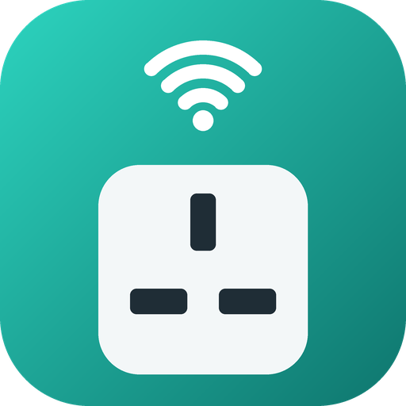

<p align="center">
  
</p>

# BG Smart Socket

[](https://hacs.xyz)
[](https://github.com/YOUR_GITHUB_USERNAME/ha-bg-smart-socket/actions/workflows/validate.yml)

Home Assistant integration for British General 2-gang smart wifi sockets. It
controls the socket locally, with no cloud account or app required.

Home Assistant's built-in Broadlink integration only provides the two on/off
switches. This integration adds child locks, auto-off timers and indicator LED
brightness.

## Entities

| Entity | Type | Description |
| --- | --- | --- |
| Socket 1, Socket 2 | Switch | Turn each outlet on or off. |
| Socket 1 child lock, Socket 2 child lock | Lock | Lock the physical switch of each outlet. |
| Socket 1 auto-off, Socket 2 auto-off | Number | Automatic shut-off timer in minutes. 0 disables it. |
| LED brightness | Number | Indicator LED brightness, 0 to 100. |

Outlets can still be switched from Home Assistant while their child lock is on.

## Supported devices

British General 2-gang smart sockets, which Home Assistant's Broadlink integration
lists as BG800/BG900:

- Outdoor IP66 smart socket (894PG). Tested on firmware 57053.
- 800 and 900 series indoor smart double sockets. These report the same device
  type and should work, but have not been tested.

## Requirements

- Home Assistant 2025.1 or newer
- A 2.4 GHz wifi network, with the socket on the same network as Home Assistant

## Installation

### HACS

1. In HACS, open the menu and select **Custom repositories**.
2. Add `https://github.com/YOUR_GITHUB_USERNAME/ha-bg-smart-socket` as an
   **Integration**.
3. Download **BG Smart Socket** and restart Home Assistant.

### Manual

Copy `custom_components/bg_socket` into the `custom_components` folder of your
Home Assistant configuration directory and restart Home Assistant.

## Connecting the socket to wifi

Skip this section if the socket is already on your network.

1. Hold both switch buttons for about 10 seconds, until they flash red. The socket
   then broadcasts its own wifi network, usually named `BroadlinkProv`.
2. Connect a computer to that network.
3. Install [python-broadlink](https://github.com/mjg59/python-broadlink) and send
   the socket your wifi details:

   ```
   pip install broadlink
   ```

   ```python
   import broadlink

   # security mode: 0 = none, 1 = WEP, 2 = WPA1, 3 = WPA2, 4 = WPA1/2
   broadlink.setup("YOUR_WIFI_NAME", "YOUR_WIFI_PASSWORD", 3)
   ```

4. The socket restarts and joins your wifi. If it does not, try security mode 4.
5. Reconnect your computer to your normal network and give the socket a DHCP
   reservation in your router so its IP address stays the same.

## Configuration

1. Go to **Settings > Devices & services > Add integration**.
2. Select **BG Smart Socket**.
3. Enter the socket's IP address and a name.

Add each socket separately. If a socket is already set up with the built-in
Broadlink integration, remove it there to avoid duplicate entities.

## Troubleshooting

- **Could not connect:** check the IP address, and that Home Assistant and the
  socket are on the same network with UDP port 80 open between them.
- **Not a supported BG smart socket:** the device at that address is a different
  Broadlink device type.

## Disclaimer

This project is not affiliated with or endorsed by BG Electrical, British General
or Broadlink. Product names are used only to identify compatible hardware.

## Licence

[MIT](LICENSE). Built on [python-broadlink](https://github.com/mjg59/python-broadlink).
